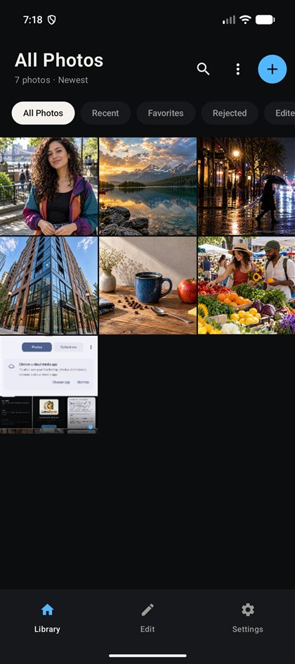
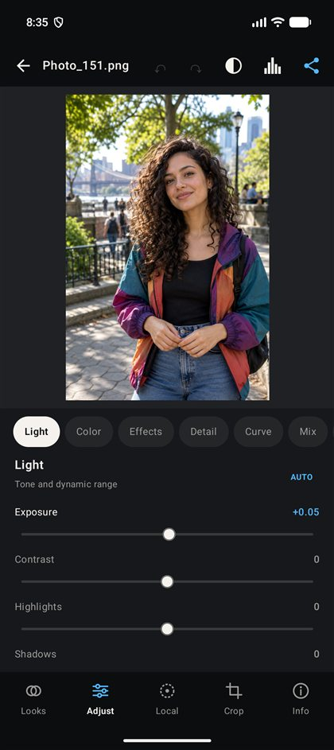
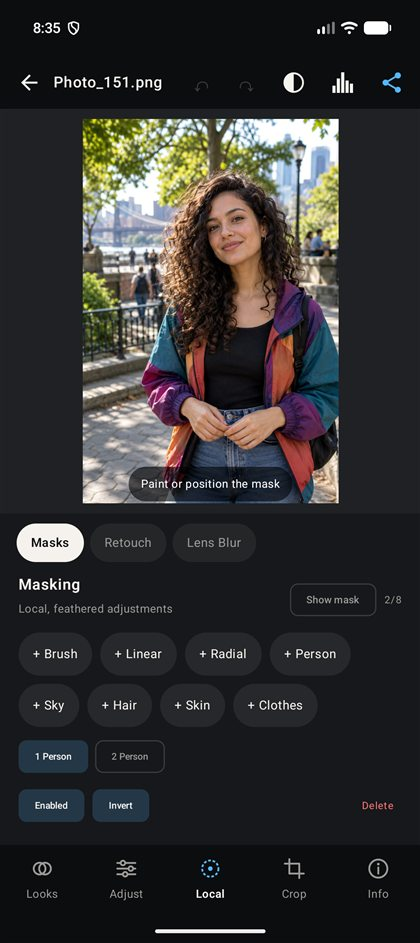
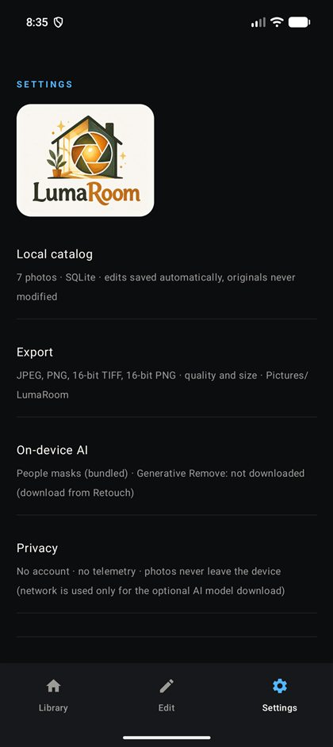

<p align="center">
  
</p>

<h1 align="center">LumaRoom</h1>

<p align="center">
  A local-first, non-destructive photo library and editor for Android.<br>
  Built with Kotlin, Jetpack Compose, SQLite and LiteRT.
</p>

<p align="center">
  <strong>Version 0.20.0</strong> · Android 8.0+ · API 36 target · No account · No telemetry
</p>

> LumaRoom is an independent application inspired by professional mobile photo-editing workflows. It is not affiliated with or endorsed by Adobe, and it contains no Adobe application code or cloud services.

## Screenshots

<table>
  <tr>
    <td align="center"><br><strong>Photo library</strong></td>
    <td align="center"><br><strong>Global adjustments</strong></td>
    <td align="center"><br><strong>Local and AI masks</strong></td>
    <td align="center"><br><strong>Local-first settings</strong></td>
  </tr>
</table>

## Overview

LumaRoom combines a local photo catalog with a non-destructive editor. The original image is never overwritten: adjustments are saved as a recipe in the app's SQLite catalog and are applied when the image is previewed or exported.

The application supports ordinary raster images, TIFF files and many camera-RAW containers. Editing and bundled people segmentation run locally. Network access is used only when the user chooses to download the optional LaMa model for Generative Remove.

### Highlights

- Local photo library with search, filters, ratings, flags and albums.
- Non-destructive autosaved editing with undo, redo and before/after comparison.
- Complete light, color, curve, detail, effects, optics and geometry toolsets.
- Brush, linear, radial, sky and on-device people-part masks.
- Heal, Clone and optional AI-assisted Generative Remove.
- Elliptical Lens Blur with manual, Person and Face focus modes.
- 680 bundled XMP preset files, live thumbnails, custom presets and preset import.
- JPEG, PNG, 16-bit TIFF and 16-bit PNG export.
- No account, advertising SDK or telemetry.

## Features

### Photo library

- Import multiple photos from the Android Photo Picker.
- Import files from local folders, removable storage, Drive-compatible providers and other Android document providers.
- Persistent access to selected files when the provider supports URI grants.
- Safe fallback copies in app storage when a persistent grant is unavailable.
- All Photos, Recent, Favorites, Rejected and Edited smart views.
- User-created albums and per-photo album membership.
- Filename search.
- Sort by import date, name or rating.
- Three thumbnail-grid densities.
- Edited thumbnails that show the saved recipe.
- One-to-five-star ratings plus Pick and Reject flags.
- SQLite-backed catalog and automatic recipe persistence.

### Editor navigation

The editor is organized into five bottom-level groups:

| Group | Tools |
|---|---|
| **Looks** | Presets and Quick looks |
| **Adjust** | Light, Color, Effects, Detail, Curve, Mix, Grading, Optics and Calibration |
| **Local** | Masks, Retouch and Lens Blur |
| **Crop** | Crop/rotate and Geometry |
| **Info** | Rating, flags, albums, copy/paste, reset and library removal |

The top bar provides Undo, Redo, before/after comparison, histogram display and Export. Holding the photo temporarily reveals the original.

### Light and tone

- Exposure in stops with highlight roll-off.
- Contrast, Highlights, Shadows, Whites and Blacks.
- Local-tone processing for Shadows, Highlights and Clarity using a blurred luminance base.
- Auto tone.
- Histogram calculated from the current preview.

### Color

- Profiles: Adobe Color, Vivid, Portrait, Neutral and Monochrome.
- White-balance presets plus Temperature and Tint.
- Vibrance with protection for skin tones and highly saturated colors.
- Global Saturation.
- Eight-channel color mixer: Red, Orange, Yellow, Green, Aqua, Blue, Purple and Magenta.
- Per-channel Hue, Saturation and Luminance controls in perceptual OKLCh space.
- B&W mixer when using the Monochrome profile.
- Shadow, Midtone and Highlight color grading with Balance.
- Red, Green and Blue primary calibration plus Shadow Tint.

### Tone curves

- Parametric Shadows, Midtones and Highlights curve.
- Editable point curves for RGB, Red, Green and Blue channels.
- Smooth monotone-cubic interpolation.

### Effects and detail

| Area | Controls |
|---|---|
| **Presence** | Texture, Clarity and Dehaze |
| **Vignette** | Amount, Midpoint, Feather and Roundness |
| **Grain** | Amount, Size and Roughness |
| **Sharpening** | Amount, Radius, Detail and Masking |
| **Noise reduction** | Luminance, Detail, Contrast and Color noise |

### Optics

- Manual lens-distortion correction.
- Lens-shading/vignette correction.
- Defringe control.
- Auto optics action.

### Local masks

Up to eight masks can be stored in one edit recipe:

- **Brush:** multiple independent strokes, size/feather/flow controls and stroke undo.
- **Linear:** movable and rotatable graduated adjustment.
- **Radial:** movable, rotatable elliptical mask with aspect and feather controls.
- **Person:** on-device full-person segmentation.
- **Hair, Skin and Clothes:** separate classes from the bundled people model.
- **Sky:** built-in heuristic sky selection.

Each mask can be enabled, disabled, inverted or deleted, and can adjust Exposure, Contrast, Highlights, Shadows, Temperature, Tint and Saturation. A red overlay can display the affected region.

### Retouch

Up to 24 retouch spots are supported:

- **Heal:** blends surrounding texture into the target.
- **Clone:** copies pixels from a draggable source point.
- **Generative Remove:** accepts taps or painted regions of arbitrary shape.
- **Classic fallback:** built-in smooth fill remains available without downloading a model.
- **LaMa mode:** optional on-device 512 × 512 inpainting with feathered, color-matched edges.

### Lens Blur and background effects

- Blur Amount and edge Feather controls.
- Draggable manual focus center.
- Elliptical focus region with size, aspect and angle handles.
- Invert mode to blur the center instead of the surroundings.
- Person and Face focus using on-device segmentation.
- Background Blur, Black & White, Darken and Pop effects driven by the people mask.

### Crop, rotation and geometry

- Free crop plus Original, 1:1, 4:5, 3:2, 16:9 and 9:16 ratios.
- Draggable crop frame with corner handles.
- 90-degree rotation and horizontal flip.
- Straighten with automatic zoom to avoid empty corners.
- Vertical, Horizontal and Aspect perspective correction.
- Manual lens distortion is included in the geometry mapping used for export.

### Presets and Quick looks

- 680 bundled XMP preset files across Cinema Grade, Cinematic, Duotone, Essentials, Film Looks, Food, HDR, Landscape, Light Leaks, Matte, Monochrome, Newborn, Nightscape, Pastel, Personal, Portrait, Vintage Film and Wedding categories.
- Live preset thumbnails rendered from the current photo.
- Preset preview before committing.
- Adjustable preset Amount from 0% to 200%.
- Favorite presets.
- Applying another preset replaces the previous preset contribution rather than stacking it blindly.
- Save a custom preset and select which groups it contains.
- Rename or delete custom presets.
- Import `.xmp` and `.lrtemplate` files.
- Quick looks: Enhance, Vivid, Portrait, Warm, Cool, Matte, HDR and B&W.

#### Lightroom preset compatibility

The importer understands common Lightroom preset data including global tone, parametric and point curves, white balance, presence, HSL, B&W mix, color grading/split toning, calibration, detail, vignette, grain, profile references and graduated/radial filters. Absolute Kelvin white balance is restricted to RAW inputs. Results are intentionally approximate because Adobe's rendering pipeline and camera profiles are proprietary.

### Photo information and workflow actions

- Star rating and Pick/Reject flags.
- Add or remove the photo from albums.
- Auto tone.
- Copy and paste edit settings between photos.
- Reset adjustments while preserving geometry.
- Reset the complete recipe.
- Remove the photo from the local catalog without modifying an external original.

### Export

| Format | Options |
|---|---|
| JPEG | Quality 50–100 and maximum output dimension |
| PNG | Lossless 8-bit output and maximum output dimension |
| TIFF | 16-bit-per-channel output |
| PNG 16 | 16-bit-per-channel PNG output |

Exports are written to `Pictures/LumaRoom`. Android 8 and 9 request legacy write permission; Android 10+ uses MediaStore. The exporter reports memory and encoding failures and removes incomplete output files.

## Supported inputs

The Gallery path accepts images exposed by Android's Photo Picker. The Files path advertises standard images, TIFF and common RAW MIME types including DNG, CR2, CR3, NEF, ARW, RW2, RAF, ORF and SRW.

RAW support is preview-oriented: when Android cannot decode a RAW container directly, LumaRoom extracts the largest embedded JPEG preview. It does not currently provide a full proprietary RAW demosaic or camera/lens-profile pipeline.

## On-device AI and privacy

| Feature | Implementation | Delivery |
|---|---|---|
| Person, Hair, Skin and Clothes masks | MediaPipe multiclass selfie segmentation through LiteRT | Bundled model, approximately 16 MB |
| Person/background effects and subject focus | Reuses the bundled segmentation output | Built in |
| Sky mask | Image-analysis heuristic | Built in |
| Generative Remove | LaMa-Dilated LiteRT model | Optional download, approximately 170 MB |

- Image processing runs on the device.
- There is no account system or telemetry SDK.
- Android application backup is disabled in the manifest.
- The `INTERNET` permission exists only for the optional model download.
- The downloaded LaMa archive is streamed, extracted and SHA-256 verified before use.

## Getting started

### Requirements

- Android Studio with a JDK 17 runtime.
- Android SDK 36.
- An Android 8.0/API 26 or newer device or emulator.
- Windows, macOS or Linux capable of running the included Gradle wrapper.

### Build a debug APK

macOS/Linux:

```bash
./gradlew assembleDebug
```

Windows PowerShell or Command Prompt:

```powershell
.\gradlew.bat assembleDebug
```

The installable debug APK is created at:

```text
app/build/outputs/apk/debug/app-debug.apk
```

Install it on a connected device:

```bash
adb install -r app/build/outputs/apk/debug/app-debug.apk
```

### Release build and signing

```bash
./gradlew assembleRelease
```

Release builds enable R8/resource shrinking and currently package only `arm64-v8a`. Signing values are read from git-ignored `local.properties` entries or matching environment variables:

```properties
lumaroom.storeFile=/absolute/path/to/lumaroom-release.keystore
lumaroom.storePassword=...
lumaroom.keyAlias=lumaroom
lumaroom.keyPassword=...
```

Environment-variable alternatives are `LUMAROOM_STORE_FILE`, `LUMAROOM_STORE_PASSWORD`, `LUMAROOM_KEY_ALIAS` and `LUMAROOM_KEY_PASSWORD`. Without credentials, Gradle produces an unsigned release artifact.

Never commit a signing keystore or its passwords.

## Tests and quality checks

```bash
./gradlew testDebugUnitTest
./gradlew connectedDebugAndroidTest
./gradlew lintDebug
```

Current suites contain:

- **33 JVM tests:** color-engine identity and adjustments, curves, preset parsing/blending, removal fill and edit-recipe serialization.
- **28 connected-device tests:** bitmap rendering, crop/geometry, mask mapping, healing/removal, Lens Blur, segmentation, decoding/orientation, 16-bit writers, export and catalog persistence.

Manual QA assets are available in [`test-assets/photos`](test-assets/photos/README.md). They cover portraits, people masks, sky/landscape editing, low-light noise, architecture/geometry, object removal and HSL/color work.

The dated QC report is available at [`QA_REPORT_2026-10-25.md`](QA_REPORT_2026-10-25.md). Some findings documented there were fixed in the subsequent `working app beta` commit, so verify the current source before treating a dated finding as still open.

## Project structure

| Path | Purpose |
|---|---|
| `app/src/main/java/com/lightroom/mobile/MainActivity.kt` | Compose application, library and editor UI |
| `EditorModels.kt` | Photo, recipe, mask, retouch, preset and export models |
| `ColorEngine.kt` | Global/local color and tone processing |
| `ImageExporter.kt` | Preview rendering, frame mapping and file export |
| `RawDecoder.kt` / `BitmapRepository.kt` | Image loading, orientation and RAW-preview decoding |
| `LibraryStore.kt` | SQLite catalog and local preferences |
| `SubjectSegmenter.kt` / `SkySegmenter.kt` | On-device semantic masks |
| `Inpainter.kt` / `RemovalFill.kt` | LaMa and classic object removal |
| `PresetImporter.kt` / `AssetPresets.kt` | XMP/LRTemplate parsing and bundled preset loading |
| `TiffPngWriter.kt` | Streaming 16-bit TIFF and PNG output |
| `app/src/main/assets/presets` | Bundled XMP presets |
| `app/src/main/assets/models` | Bundled segmentation model and model notes |
| `app/src/test` | JVM unit tests |
| `app/src/androidTest` | Connected Android tests |
| `docs/screenshots` | Optimized README screenshots |
| `test-assets/photos` | Generated manual-QA photo pack |

## Technical notes and current limitations

- Minimum Android version is API 26; compile and target SDK are API 36.
- The release configuration is ARM64-only. Debug builds include emulator-compatible native libraries supplied by dependencies.
- The editor catalog is local; there is no cloud sync, collaboration or desktop/web companion.
- The app edits photos only; video editing is not supported.
- RAW handling may use an embedded JPEG preview instead of a true sensor-data demosaic.
- The optional LaMa model is large and can use substantial memory during inference.
- Dependency-provided native libraries should be verified on physical 16 KB-page ARM64 devices before production distribution.

## Additional documentation

- [`architecture.md`](architecture.md) — project structure, render pipeline and technical decisions.
- [`sdd.md`](sdd.md) — data model, algorithms and component contracts.
- [`diff.md`](diff.md) — historical change log.
- [`app/src/main/assets/models/README.md`](app/src/main/assets/models/README.md) — model origins and licensing notes.
- [`QA_REPORT_2026-10-25.md`](QA_REPORT_2026-10-25.md) — dated QA findings and comparison with Lightroom Mobile.
