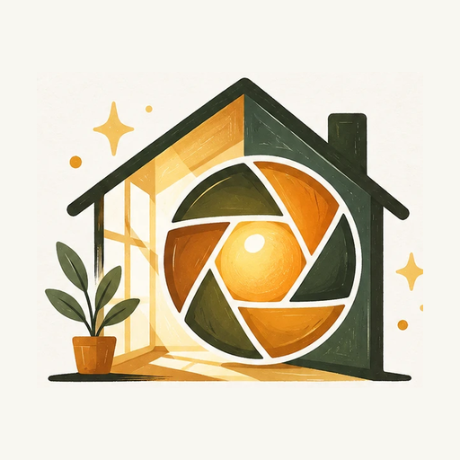

<p align="center"></p>

# LumaRoom

**Version 0.20.0** (versionCode 20). See [diff.md](diff.md) for everything that changed on 2026-10-24.

An original Android photo library and non-destructive editor modelled on Lightroom Mobile's workflow and controls. It is an independent app: no Adobe code, branding or cloud services. Everything runs on the device, including the AI tools.

## Features

### Branding
- The app is called **LumaRoom**. Its logo (a house with a camera aperture and a plant) is the launcher icon: an adaptive icon on a cream `#F8F7F1` background, with a round variant and densities from mdpi to xxxhdpi.
- The full logo with its wordmark appears on the empty Library screen and at the top of Settings. A 512 px copy for stores and docs is in [docs/icon-512.png](docs/icon-512.png).

### Library
- Import from the **Gallery** (Android photo picker: all photos and albums, no storage permission) or **Files** (RAW, TIFF, Drive, folders). Access is kept across restarts; photos whose grant can't be kept are copied into app storage.
- All Photos, Recent, Favorites, Rejected, Edited views and user albums; filename search; sort by date, name or rating; three grid sizes. Thumbnails show each photo's edit.
- Gallery photos are named from their capture date (`IMG_20261024_052310.jpg`), since the picker only reports a media id.
- Star ratings, pick/reject flags, a SQLite catalog, and edits saved automatically. Originals are never modified.

### Editor
Tools are grouped in a bottom bar: **Looks · Adjust · Local · Crop · Info**.

- **Live preview = export.** The preview is rendered by the same colour engine as the export (a fast draft while dragging, then full quality), so what you see is what you save. Tap ◐ (or hold the photo) for before/after; the histogram follows the edit.
- **Light:** Exposure (in stops, with highlight roll-off), Contrast, Highlights, Shadows, Whites, Blacks. Shadows/Highlights and Clarity are *local* (they read a blurred base layer, like Lightroom's tone mapping) so they don't flatten the image.
- **Color:** profiles (Adobe Color / Vivid / Portrait / Neutral / Monochrome), white-balance presets, Temperature, Tint, Vibrance (protects skin and already-saturated colours), Saturation, all on colour-gradient sliders.
- **Color mixer (HSL):** eight bands (Red, Orange, Yellow, Green, Aqua, Blue, Purple, Magenta) working in the perceptual OKLCh colour space: each band moves only its own colours, bands blend smoothly (no banding), greys are never shifted, and luminance changes never shift hue. B&W mixer for the Monochrome profile.
- **Color grading:** a colour wheel per Shadows / Midtones / Highlights, with Hue, Saturation and Balance.
- **Calibration:** red, green and blue primary hue and saturation, and shadow tint.
- **Tone curve:** parametric (shadows/midtones/highlights) and a point curve per RGB/Red/Green/Blue, smooth (monotone cubic) like Lightroom's.
- **Effects:** Texture, Clarity, Dehaze, post-crop Vignette (amount, midpoint, feather, roundness), Grain (amount, size, roughness).
- **Detail:** sharpening (amount, radius, detail, masking) and noise reduction (luminance, detail, contrast, color). New edits start with sharpening and color NR at 0, Lightroom's defaults for JPEGs, so an untouched export matches the original.
- **Optics:** lens distortion, lens shading and defringe, with Auto.
- **Masks (up to 8):** Brush (separate strokes, undo stroke), Linear (starts as a top-down gradient), Radial (round in real pixels) and AI masks: **Person, Hair, Skin, Clothes** (on-device people segmentation) and Sky. Each has exposure, contrast, highlights, shadows, temperature, tint and saturation, plus invert, feather and enable.
- **Retouch (up to 24 spots):** Heal/Clone with a draggable source, and **Generative Remove**: paint over any object shape (tap to dab). With the optional LaMa AI model the area is regenerated and its edges are colour-matched; otherwise a smooth fill is used.
- **Lens Blur** with a draggable focus point, and AI **background** effects (blur, B&W, darken, pop behind people).
- **Crop & rotate:** a draggable crop box with corner handles (Free, Original, 1:1, 4:5, 3:2, 16:9, 9:16), 90° rotation, flip (mirrors the photo as shown, whatever its rotation), and Straighten that zooms just enough to hide empty corners. **Geometry:** vertical, horizontal and aspect correction, previewed through the same perspective matrix the export uses.
- **Presets:** 400+ bundled Lightroom-format presets (Cinematic, Duotone, Essentials, Food, HDR, Landscape, Light Leaks, Matte, Monochrome, Newborn, Nightscape, Pastel, Portrait, Vintage Film, Wedding) with live thumbnails of your photo. Tap to preview, Apply to keep, tap an applied preset to remove it; another preset replaces it rather than stacking. 0–200% amount, favorites.
- **Your presets:** save the current edit with a name and the setting groups to include (like Lightroom's Create Preset); long-press to rename or delete. Import `.xmp` / `.lrtemplate` files.
- **Quick:** Auto enhance, Auto straighten, Auto white balance, and one-tap looks that behave like presets.
- **Info:** rating, flags, albums, copy/paste settings, reset, remove from library.
- **Export:** JPEG (quality), PNG, 16-bit TIFF, 16-bit PNG (with every effect applied), at a chosen maximum size, to `Pictures/LumaRoom` (Android 8–9 ask for storage permission). Failures say why, e.g. not enough memory, and never leave half-written files.

### Lightroom preset compatibility
The importer reads tone (incl. the parametric curve), white balance, presence, HSL, B&W mix, colour grading / split toning, point curves, **camera calibration**, detail, post-crop and lens vignette, grain size/roughness, Look profiles, and graduated/radial filters (as Linear/Radial masks). Absolute (Kelvin) white balance is applied only to RAW files, as Lightroom does. Presets only change the settings they define. Results are close to Lightroom but not identical, because Adobe's processing and camera profiles are proprietary.

### On-device AI (LiteRT)
| Feature | Model | Delivery |
|---|---|---|
| Person / Hair / Skin / Clothes masks, background effects | MediaPipe multiclass selfie segmenter (Apache-2.0) | Bundled, 16 MB |
| Generative Remove | LaMa-Dilated, Qualcomm AI Hub build (Apache-2.0) | Optional 170 MB download from Retouch, SHA-256 verified |
| Sky mask | Heuristic | Built in |

Photos never leave the device; the network is used only for the optional model download.

## Build

Open the folder in Android Studio and let Gradle sync, or use the wrapper:

```bash
./gradlew assembleDebug
```

- Android 8.0+ (`minSdk 26`), Kotlin, Jetpack Compose, Material 3, LiteRT.
- Gradle 9.3 wrapper with AGP 8.13. Both run on Android Studio's bundled JDK, including release lint.
- Release builds are shrunk with R8 (about 22 MB, arm64 only).
- **Release signing** reads `lumaroom.storeFile`, `lumaroom.storePassword`, `lumaroom.keyAlias` and `lumaroom.keyPassword` from `local.properties` (git-ignored) or the `LUMAROOM_*` environment variables. Without them, the release APK is built unsigned.

## Tests

```bash
./gradlew testDebugUnitTest          # JVM: colour engine, presets, importer, fills
./gradlew connectedDebugAndroidTest  # on a device/emulator: every editing feature on real bitmaps
```

- `ColorEngineTest`: default settings are an identity; each HSL band moves only its colours and never greys; hue shifts are continuous across band edges; exposure is in stops; WB, vibrance, monochrome/B&W mix, tone ranges, grading and calibration act as in Lightroom; curves are smooth and monotone.
- `PresetImportTest` / `PresetBlendTest`: all 423 bundled presets parse; calibration, parametric curves and local filters import; RAW-only white balance; presets touch only their fields.
- `FeatureTest` (on device, 28 tests): crop/rotate/straighten frames, flip after rotation, masks following the crop and lens distortion on export, legacy-crop migration, separate brush strokes, colour NR, 16-bit PNG streaming and 16-bit lens blur, edited thumbnails, preset round-trip/removal, heal/clone, Generative Remove (classic and LaMa), brush/linear masks, lens blur, sharpening and NR, vignette/grain, clarity, people segmentation, EXIF orientation, decode size, 16-bit writers, a full export, the catalog keeping edits, bundled presets, and preview/export colour parity.

## Documents
- [diff.md](diff.md): dated log of every change made to this repository.
- [architecture.md](architecture.md): structure, render pipeline and key decisions.
- [sdd.md](sdd.md): data model, algorithms and component contracts.
- [app/src/main/assets/models/README.md](app/src/main/assets/models/README.md): AI models.
