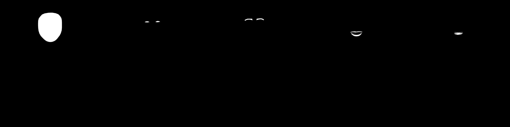

# Advanced masks, person regions and Generative Remove

## Current implementation

- Add, Subtract and Intersect combine component coverage with the first mask's adjustments. Disabled components are ignored; disabling the first mask disables its group. Deleting a group base removes its components. Luminance range applies to each component before combination.
- The bundled ML Kit detector finds face contours on device. Face, eyes, eyebrows and lips are rasterized with antialiased edges. The existing person model still supplies person, hair, skin and clothes masks.
- Teeth are **experimental**: the detector supplies an inner-mouth contour, then the app selects bright, low-chroma pixels within it. This is not a trained tooth segmentation model. Shadowed/yellow teeth, reflections and a visible tongue can need manual Brush refinement.
- LaMa runs locally after an optional, SHA-256-verified 182 MB model download. The built-in classic fill is used until the model is ready or if inference fails. A memory failure no longer deletes the verified model.

## Checks

- 46 JVM tests pass, including mask Boolean operations, a disabled base, luminance range and face-mask recipe serialization.
- Android instrumentation exercises a real portrait with visible teeth. The Face, Eyes, Eyebrows, Lips and Teeth masks all produce localized selections. The detected masks appear below, in that order from left to right.
- The combined-mask overlay is tested for a radial subtraction hole and a bright pixel excluded by the luminance range.
- The verified LaMa model was installed on the Pixel_10a Android 17 emulator. Real inference filled a dark patch in a blue scene while retaining the untouched exterior. The test passed with the model installed.

## Accuracy and device limits

- Facial contours are most reliable when the face is clear and sufficiently large. The detector may miss small, turned, obscured or blurred faces; the app reports that and Brush remains available. The current selection targets the prominent face when multiple faces are present.
- The tooth control is a heuristic and must not be described as fully accurate. A dedicated, validated facial-part segmentation model would be needed for robust teeth selection across lighting and skin tones.
- LaMa takes substantial storage and working memory, and a 512 px context window cannot guarantee convincing reconstruction for every object or scene. Results need visual review, especially text, repeated structure and large removals. No broad multi-device quality benchmark has been completed.
- The emulator run establishes execution on that environment. Physical low-memory and ARM64/16 KB devices still need acceptance testing.
