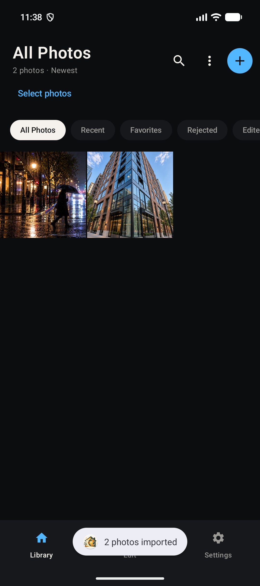
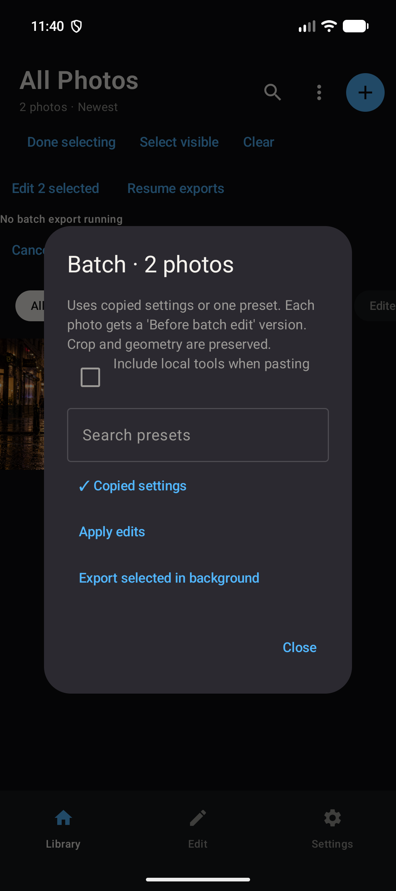
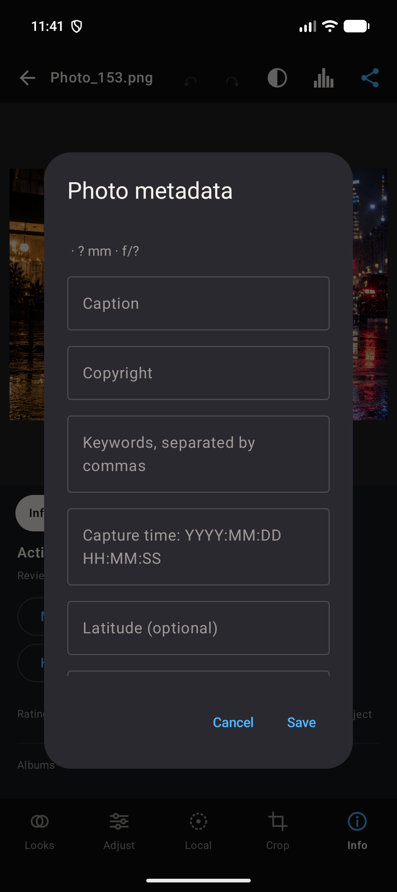

# P0 implementation QA — 25 October 2026

Scope: RAW development, camera/lens profiles, batch edits/export, persistent history/versions and rich metadata. Tested on Pixel_10a Android 17/API 37 x86_64 emulator; release compiled for ARM64. Tests do not establish support for every physical device or camera.

## Automated checks

| Check | Result | Coverage |
|---|---|---|
| Debug APK build | Pass | ARM64 + x86_64 native RAW engine and Compose UI |
| Release APK build | Pass | ARM64, R8/resource shrinking; unsigned because no signing credentials were configured |
| JVM tests | 42 passed using direct JUnit | Existing color/preset/fill/serialization tests plus metadata validation/search/XMP escaping, batch preservation rules and calibrated lens-model interpolation |
| Connected tests | 41 passed, 1 skipped, 0 failures | Original 28 tests plus 14 workflow/native tests |
| Optional LaMa inference test | Skipped | Model is not installed on the emulator |
| Android lint | 0 errors; 57 warnings; 2 hints | Warnings remain open; passing lint is not a clean-warning claim |
| RAW native ELF alignment | Pass | ARM64 and x86_64 LOAD segments have alignment `0x4000` |
| Debug APK zip alignment | Pass | `zipalign -c -P 16 4` |
| Diff whitespace check | Pass | `git diff --check` |

The ordinary Gradle JVM-test launcher fails on this workstation because an unmatched quote in the inherited Windows native-library path splits the Java command line. This is a local test-launcher problem, not a passing Gradle-test result. The same freshly compiled test classes and dependencies were run with `org.junit.runner.JUnitCore`; all 42 passed. Normal Gradle commands remain documented for other environments.

### Native and workflow cases exercised

- Sensor-only Bayer DNG without any JPEG preview; corrupt RAW rejection.
- A 600 × 600 synthetic X-Trans sensor-only DNG, large enough for LibRaw's 512px interpolation tile.
- RGB input ICC validation and use; malformed ICC rejection.
- RAW 16-bit samples and TIFF export contain precision beyond multiples of 257 (an 8-bit expansion).
- Lens correction retains 16-bit samples and neutral calibration maps pixels correctly.
- Lens database loads; unknown or ambiguous names are not guessed.
- Version-2 catalog migration preserves photos, ratings and edits.
- History survives reopening, deduplicates unchanged states and records reset to original.
- Named versions capture metadata and profile choices.
- Batch paste preserves each photo's crop/local edits by default and creates recoverable versions.
- Export queue snapshots recipes/metadata/options instead of reading later changes.
- Queue cancellation, foreground-service export while the activity is backgrounded, success for a valid file and individual failure for an unavailable file.
- JPEG EXIF/XMP export with GPS both enabled and disabled.
- PNG, PNG16 and TIFF16 XMP with metadata enabled/disabled; no GPS by default.

## Gaps discovered and corrected during implementation

| Gap | Correction |
|---|---|
| A profile change could leave an old editor or library image cached. | Decoder revision invalidates source and edited thumbnails and reloads the editor. |
| Restoring a version originally restored only slider settings. | Versions now retain metadata/camera/lens choices and restore them too. |
| A batch could silently overwrite per-photo crop/local tools. | Geometry is preserved; copying local tools requires an explicit choice. A pre-batch version is stored transactionally. |
| Queue exports could use profile choices changed after enqueueing. | Metadata and profile choices are included in each job's immutable snapshot. |
| Retrying one bad file could prevent later exports. | Failure is stored per image; the serial queue continues. Failure reason and retry/cancel controls are exposed. |
| A start arriving as the service finished could strand newly queued jobs. | The service rechecks the queue before stopping. |
| RAW initially reached the editor pipeline through an 8-bit bitmap only. | Export carries a separate 16-bit buffer through lens/geometry/color processing. |
| A 16-bit buffer with its position at the end appeared empty. | Lens correction reads a cleared duplicate and checks capacity. |
| Small X-Trans test data was rejected by LibRaw. | The fixture now meets the upstream minimum 512px tile dimensions; actual decode is tested. |
| Existing segmentation assertion expected the 256px model output instead of the 384px refined mask. | Assertion now checks the refined result and confidence-array dimensions. |
| Local SDK path prevented lint execution. | Corrected the machine-local Java-properties path escaping. |

## Remaining gaps / acceptance work

| Priority | Open item | What still needs to happen |
|---|---|---|
| High | Android 16 KB compatibility warning still appears on debug startup. | The emulator lists the native library set, with LiteRT reporting an unaligned LOAD segment. The new RAW library and APK pass their alignment checks. Upgrade/verify all dependency binaries and test the complete ARM64 release on a physical 16 KB device. |
| High | Real-camera and memory coverage is incomplete. | Test representative CR2/CR3/NEF/ARW/RAF/DNG files, clipped highlights, unusual WB, large frames and low-memory phones. Synthetic sensor fixtures establish code-path correctness, not measured color accuracy for every camera. |
| Medium | DCP and some Lensfun calibration/projection models are unsupported. | ICC camera inputs are implemented. Add DCP color/tone/look tables and ACM/fisheye projection support before claiming full Lightroom profile parity. |
| Medium | Lens shading calibration is approximate between available apertures. | Implement multi-dimensional focal/aperture/distance interpolation; verify crop/aspect normalization against the Lensfun reference implementation and measured images. |
| Medium | RAW processing is not an end-to-end scene-linear HDR engine. | Preview and several spatial effects still use 8-bit bitmaps. RAW color processing/export preserves 16-bit samples, but floating-point HDR and sensor-domain WB/exposure control require another pipeline stage. |
| Medium | A process interruption at the publication/queue-commit boundary can duplicate an export on Resume. | Add an idempotent output identifier/reconciliation step. Queue processing currently provides at-least-once recovery. |
| Medium | Unsaved editor changes within the existing autosave debounce can be lost on process death. | Persist editor session state/lifecycle flush separately from settled history. Previously saved edits/versions remain available. |
| Medium | Local Gradle JVM-test launcher is broken by the workstation's quoted native-library path. | Repair the malformed Windows PATH entry; direct JUnit passed the compiled suite. |
| Low | Full metadata interoperability is not tested in external DAM software. | Check supported EXIF/XMP fields in Lightroom, ExifTool and gallery apps. Manufacturer MakerNotes and every EXIF tag are not copied. |

## Visual checks

Imported two existing test photos through Android Photo Picker, opened the editor, entered selection mode, selected both photos and opened the batch dialog. Checked metadata form layout and navigation. No source photos were overwritten.

| Library | Batch actions | Metadata |
|---|---|---|
|  |  |  |

The startup warning is retained separately as [compatibility evidence](screenshots/p0-compatibility-warning.png).

Current workflow instructions and limitations: [P0_FEATURES.md](P0_FEATURES.md). No claim is made that the app has no additional bugs.
